# RawProd production floor plan: PO to doorstep

Status: PLAN, not built. Nothing here is coded until the owner approves it.
Base: `lane/qc-gate` @ 591ee13 (live). Survey of what exists: section 0.

---

## 0. What already exists and what we build

| Area | Today (lane/qc-gate) | Build |
|---|---|---|
| Vault secrecy | Per-formula key (AES-256-GCM); `formula:actual:read` only for formulator and vault_approver | Nothing new on secrecy. Add a **disclosure-safe floor view** (section 3) |
| Anonymised codes | `masterdata.rm_alias` ("ING-A001"); the pick list is coded | **Colour code and number per ingredient, and a barcode that resolves inside the system** |
| PO | Create → approve → issue → acknowledge → amend/cancel; approval matrix | **Payment release gate** (today an advance is recorded as PAID by default) |
| Delivery | Gate entry → GRN with accepted/rejected/damaged/variance (SHORT/EXCESS/DAMAGED) | **Receiving checklist, the 20% rule, partial accept** |
| Racks | Rack/bin/shelf masters, putaway tasks, bin QR labels, pick-to-light | **Rack colour zones; raw-lot label printed at putaway** |
| Lots | RM batch, oil batch, FG batch, genealogy, consumption | **One scannable lot id on every label** and a full trace screen |
| Orders in | Alembic → `ProductionRequirementCreated` → production plan/order | **Floor queue with the alternating priority rule** |
| Floor steps | Pick list → material issue → mixing session/step log → weighing → filling → packaging | **Picker, Verifier, Mixer stations as checklists; a label at each hand-off** |
| QC | Specs, inspections, ACCEPT/REJECT/HOLD/REWORK, CAPA, COA, quarantine | **Checkpoint configurator in admin; rejection decision table** |
| FG | FG bin stock, FG label with location | **Branded customer label; colour/initial rack zones** |
| Logistics | Dispatch docs (challan, invoice, e-way bill, packing list, POD) | **Courier assignment, AWB scan, tracking to Alembic and WhatsApp** |
| Maceration | IN_MATURATION state; final QC required after maturation | **Admin toggle, minimum days, timer, alarm, freeze** |
| Hardware | Browser print only | **Device registry and pairing: printers, TVs, kiosk tablets** |
| Order intelligence | none | **6-month demand model → suggested production** |
| Roles | 15 factory roles; picker/verifier/mixer folded into compounding/production | **3 floor roles + logistics** (section 10) |

---

## 1. The flow

```mermaid
flowchart LR
  PR[Purchase request] --> PO[PO raised]
  PO --> POV[PO verified / approved]
  POV --> PAY[Payment released<br/>finance, against PO]
  PAY --> DEL[Delivery at gate<br/>against PO]
  DEL --> AUD[Material audit<br/>checklist vs PO]
  AUD -->|line short ≥20%| REJ[Reject line<br/>debit note / vendor return]
  AUD -->|within tolerance| ACC[Accept; record deficit or extra]
  ACC --> IQC[Incoming QC<br/>quarantine until pass]
  IQC --> PUT[Putaway to RM rack<br/>raw-lot label printed]

  ORD[Order: storefront / CRM<br/>or Order intelligence] --> Q[Floor queue<br/>kiosk / TV]
  PUT -. stock .-> Q
  Q --> PICK[1 Picker<br/>checklist, scan rack + lot<br/>label: PICKED]
  PICK --> VER[2 Verifier<br/>weighs per formula<br/>label: VERIFIED]
  VER --> MIX[3 Mixer<br/>step-by-step blend<br/>label: MIXED]
  MIX -->|maceration on| MAC[Maceration<br/>30-120 days, timer<br/>QC 1 before, QC 2 after]
  MIX -->|off| QC[4 QC<br/>configured checkpoints]
  MAC --> QC
  QC -->|pass| FG[FG rack<br/>QC approved, colour zone]
  QC -->|fail| RJ[Rejection flow<br/>section 7]
  FG --> PACK[5 Packing<br/>fill, seal, customer label<br/>carton scan + weigh<br/>label: PACKED]
  PACK --> LOG[6 Logistics<br/>docs auto, courier, AWB scan<br/>label: SHIPPED]
  LOG --> TRK[Tracking: admin, CRM,<br/>customer portal, WhatsApp]
```

Every arrow writes one row to the stock ledger and one to the lot genealogy.
Nothing moves without a scan, so the system always knows where every gram is.

---

## 2. Hardware: pairing printers, TVs and kiosk tablets

**Model.** Add `device.device_master` (id, kind `label_printer | display | kiosk`,
station, site, name, status, last_seen) and `device.device_token`. The token is
hashed, revocable, and scoped to one station.

**Pairing (for all device kinds).**
1. Admin → Platform → Devices → *Add device* → picks the kind and the station
   (e.g. "Picker bay 1"). The system shows a **6-digit code and a QR** that are
   valid for 10 minutes.
2. On the device, open `rawfactory…/pair` → enter the code or scan the QR.
3. The device receives a station-scoped token. It is **not a user login**: a
   paired kiosk shows only its station's screen, and a person still signs in
   with a PIN or badge to act. That way each action names the person who did it.
4. Unpair/revoke works instantly. A heartbeat every 60s marks the device
   offline, and an offline printer raises an alert at its station.

**Printers.** A browser can't talk to a thermal printer reliably, so:
- **Print agent**: a small service on a PC or Raspberry Pi next to the printer.
  It pairs like a device, pulls jobs from `device.print_job` (queued → sent →
  printed / failed) and prints raw ZPL/TSPL over the network. It retries with
  backoff and parks a job after N attempts, the same pattern as pick-to-light
  today.
- **Fallback**: browser print with the existing 100×50 / 100×150 templates, so
  the floor never stops if the agent is down.
- **Reprint** is logged with the reason and the person, and the label says
  "REPRINT". A duplicate lot label is a recall risk.

**Displays (TV).** A read-only paired screen per area: the floor queue, the
maceration timers, the QC backlog. It refreshes via the existing event stream.

**Kiosk tablets.** Full-screen PWA locked to one station's checklist, with a
camera or Bluetooth scanner for barcodes. Large touch targets for gloved hands.
If the network drops, it says so and blocks completion (no offline writes, so
two kiosks can't both claim the same lot).

---

## 3. Vault labels: anonymous to people, fully known to the system

- Each ingredient gets a **floor code**: colour + number, e.g. `BLUE-0417`. The
  colour is a family band the owner chooses (e.g. citrus = yellow, musk = grey)
  or random. The family scheme helps pickers, but it leaks a little information,
  so this is an **owner decision** (section 12).
- Each **raw lot** of that ingredient gets a barcode (Code128 or QR) whose
  payload is **only an opaque id** (`L-7Q3K9X`). There is no name, CAS or
  percentage in it. Scanning it calls the API, which resolves it under the
  scanner's permissions:
  - floor roles see: floor code, colour, rack/bin, lot, quantity left, expiry,
    hazard pictograms
  - formulator/vault_approver see the real ingredient
- Recipes and formulas also get floor codes (`F-0093`, `R-0093-v4`). The mixer's
  instructions are steps on coded ingredients with quantities in grams; the
  percentages and names never reach the floor.
- One rule: **the label never carries a regulatory claim the data doesn't
  hold.** Hazard pictograms are printed only from a sourced classification. If
  there is none, the label prints "Classification pending: handle as hazardous".

---

## 4. Purchase to rack

| Step | Who | Rule |
|---|---|---|
| PO raised | Purchase | From purchase request or reorder suggestion |
| PO verified | Approver (matrix by value) | Already exists |
| **Payment released** | Finance | New gate: `po_payment_release` (requested → approved → released with UTR/ref). Advance %, or against GRN, per vendor terms. Released only by a role that did not raise the PO (maker-checker) |
| Delivery | Gate | Gate entry against an open PO; an unknown vendor or no PO → held at gate |
| **Material audit** | Receiving | Kiosk checklist per PO line: count/weight, seal intact, label matches, COA present, expiry, damage. Each item is ticked or marked with a reason |
| Deficit/extra | System | `received − ordered` per line, recorded on the GRN |
| **20% rule** | System proposes, auditor confirms | Line short **≥20%** → line rejected, rest accepted. Short <20% → accept and record the deficit. Vendor balance or debit note raised automatically |
| Incoming QC | QC | Lot stays in **quarantine** (unpickable) until QC passes |
| Putaway | Warehouse | Scan the bin → raw-lot label printed (floor code, colour, lot, quantity, expiry, hazard, date) |

**What "20%" means (owner to confirm, section 12):** per PO line, by quantity.
**Extra** above the ordered quantity is accepted up to a tolerance (default 5%),
and above that only with purchase approval. A damaged or failed-QC quantity
counts as short. The threshold is a setting, not a hard-coded number.

---

## 5. Floor queue: which order to make next

Inputs: confirmed orders from the storefront and CRM (already arriving as
`ProductionRequirementCreated`) plus the suggestions from order intelligence.

**Ordering rule (as asked): alternate new and delayed.**
- Two lanes: **New** (not past its promise date) and **Delayed** (past its
  promise date or SLA).
- The queue interleaves them: New, Delayed, New, Delayed… with New first. Within
  New the oldest is first (FIFO). Within Delayed the most overdue is first.
- Overrides above the rule: an expedite flag set by the admin, then trade orders
  with a date commitment. Suggested (intelligence) jobs sit **below** every
  customer order.
- A job only enters the queue when **all its materials are available** in
  released lots. If not, it shows as "Waiting on BLUE-0417 (PO-123 due 12 Nov)"
  rather than letting a picker start and get stuck.

**Lot picking rule:** FEFO (first expiring first out), then FIFO by receipt
date. LIFO is never used for picking stock, because it leaves old lots to
expire. The system **tells the picker which lot to take** and refuses a scan of
a different lot unless the picker gives a reason (e.g. "drum seal broken").

---

## 6. Stations: Picker → Verifier → Mixer

All three are kiosk checklists. Each line is a scan or a tick, and the station
can't complete with an open line. Each completion prints a hand-off label.

**1 Picker**
- Signs in (badge/PIN) → sees their queue (section 5).
- Per line: go to the rack (pick-to-light lights it) → scan the bin → scan the
  lot → enter or confirm the quantity taken → tick.
- Done → label **PICKED · Order SO-1234 · Job J-88 · tote T-12 · picker name ·
  time**, and stock moves from rack to the "picked" location.

**2 Verifier (perfumer)**
- Scans the tote → the checklist shows every coded ingredient and the target
  grams per the formula vault.
- A connected scale (later phase; manual entry first) records the actual
  weight. Tolerance per line (default ±1%, set per formula). Outside tolerance →
  can't tick; re-weigh or call a supervisor.
- Leftover goes back to stock as a partial lot with a new label.
- Done → label **VERIFIED**.

**3 Mixer / blender (perfumer 2)**
- Step-by-step from the vault's coded recipe: add order, stirring time,
  temperature and rest, each step timed and ticked. Out-of-order or skipped steps
  are refused.
- Done → creates the **production batch / lot** (genealogy links every raw lot
  used) → label **MIXED · batch B-2611-014**.
- If maceration is on for this product → goes to maceration (section 8), else to
  QC.

A person cannot verify their own pick or QC their own mix (segregation of
duties, enforced by the system).

**4 QC**: section 7.

**5 Packing station** (after QC approves; today's `filling_session`,
`package_order`, `packaging_qc` and `fg_label_record` are reused)
- Scans the approved batch → the checklist shows the order lines: pack size
  (10 ml, 100 ml, 1 kg…), the number of units, and the container type.
- Per line: fill or decant → scan each container's label → net weight within
  tolerance → seal / cap / tamper seal ticked → the **branded customer label**
  (RAW AROMA CHEM design, product name, size, batch/lot, QC-approved mark,
  date, and hazard pictograms only where sourced) prints automatically.
- Carton: scan each unit into the carton (the scan proves the right lot went to
  the right order) → weigh the carton → DG marks and orientation arrows if
  hazardous → **carton label** (order no., carton 1 of N, gross weight, lot
  list) → packing list printed and put inside.
- A wrong unit scanned into the carton (another order or lot) is refused.
- Leftover from the batch → sealed, labelled and moved to the FG rack as stock.
- Done → status **PACKED**; the carton moves to the dispatch bay and appears
  on the logistics station's queue.

**6 Logistics station** (section 9 holds the rules)
- Queue: packed cartons waiting to ship, oldest promise date first.
- Per shipment: scan each carton (all N must be present, otherwise it can't
  ship) → documents generated automatically (invoice, packing list, e-way bill
  where required, DG declaration) and printed → pick the courier → book the
  pickup → **scan or type the AWB** → print the courier label, or attach the
  courier's own.
- Handover: the courier collects, the station marks **HANDED OVER** with the
  time and the courier person's name, and tracking goes out (section 9).
- Exceptions: courier didn't come (re-book), a carton is damaged at handover
  (back to packing), the address doesn't match the invoice (hold and alert CRM).

Hand-off labels across the chain: PICKED → VERIFIED → MIXED → (MACERATING) →
QC APPROVED → PACKED → SHIPPED. Each one carries the order no., batch/lot, the
person and the time, so any container can be traced back to every step.

---

## 7. QC: configurable checks and rejection

**Configurator (admin):** per product (or product family), a list of
checkpoints. Each one has:
- a name (colour, odour profile, consistency, strength, clarity, density, pH,
  refractive index…)
- a type: pass/fail, numeric range, or comparison to the reference/standard
- whether it is critical
- a photo requirement
- the instrument
- versioning: a spec change applies to new batches only, and old batches keep
  the spec they were tested on

Today's `product_qc_spec` and `qc_parameter_master` are extended rather than
replaced.

**Decision table**

| Result | Decision | What happens |
|---|---|---|
| All pass | **APPROVE** | Branded customer label printed; batch goes to the FG rack; Alembic is told it's ready |
| Minor (non-critical) fail, within rework limits | **REWORK** | Back to the mixer with QC's note (e.g. strength low → adjust). Max 2 reworks, then reject |
| Borderline / instrument doubt | **HOLD → retest** | Quarantined; a second QC person retests a fresh sample |
| Critical fail (wrong odour profile, contamination, colour off-standard beyond limit, foreign matter) | **REJECT** | Batch quarantined; CAPA opened; order goes back to the queue (expedited); stock written off or returned for disposal with a reason |
| Fails on a raw material traced to one lot | **REJECT + LOT HOLD** | That raw lot is frozen everywhere; every other batch that used it is flagged for review (genealogy) |

**When a raw lot is wrong or faulty:**
- Incoming QC fails → reject the lot, return it to the vendor, debit note,
  vendor score drops.
- Found later (a batch fails and the cause is the lot) → freeze the lot; list
  every batch and every **shipped** order that used it → recall review screen
  for the admin. The lot number is the recall mechanism, so it must be on every
  label from receiving to the customer.
- Expired lot → automatically unpickable; it can be retested and re-dated by QC
  only with evidence.
- Wrong label at receiving (it says X but tests as Y) → reject; never relabel
  on the floor.

**When NOT to reject:** the deviation is inside the configured tolerance, a
cosmetic issue on a non-critical point that the spec allows, or a single failed
reading that a retest of a correctly drawn sample passes. One retest is allowed;
two fails reject.

---

## 8. Maceration

- Admin toggle per product: **Maceration required** with a minimum and maximum
  number of days (30–120), and, where applicable, the temperature or **freezing
  step** (chill and filter).
- Flow: Mixer → **QC 1** (pre-maceration) → maceration (status IN_MATURATION,
  start time stamped) → timer → **freeze/chill-filter** step → **QC 2** → FG.
- While macerating, the batch **cannot** be shipped, moved to the FG rack or
  reserved to a different order. The system enforces this, so it is not just a
  warning.
- The timer is shown on the TV and in the batch screen ("Day 23 of 45").
- When it ends: an alarm at the production station and a CRM notification
  ("Maceration complete: in QC"), and the CRM/storefront order status updates.
- Early release: only an admin can release early, with a reason, and QC 2 is
  still required. Extending the time is allowed and logged.

---

## 9. Logistics and tracking

1. Approved FG for an order → **dispatch task**.
2. Documents generated automatically from the order and invoice: tax invoice,
   packing list, and an e-way bill where the rules require it (the threshold and
   rules are settings; the generator only fills fields we actually hold, and
   blank means blank), plus a DG declaration for hazardous goods.
3. Assign courier (manual pick from the transporter list first; courier APIs are
   a later phase and an owner decision).
4. **AWB**: scan the courier receipt barcode or type it. It is validated as
   non-empty, unique, and in the courier's format where known.
5. RawProd sends a `Dispatched {awb, courier, lot list}` event (extending the
   existing one) to Alembic → shown in admin, CRM and the customer portal.
6. Customer WhatsApp (via the Interakt wiring already in Alembic): "Shipped, track
   here". The link opens **our storefront tracking page first**, which shows the
   live status, the documents attached to the order (invoice, COA, SDS where we
   hold one) as downloads, and a button to the courier's own site.

---

## 10. Roles

New floor roles, added to `scripts/ra-roles.ts` with the existing
grant-refusal rules:

| Role | Can | Cannot |
|---|---|---|
| picker | see queue, pick, scan lots, print PICKED | see grams per formula, see real ingredient names |
| verifier | weigh against formula grams (coded), print VERIFIED | see percentages/names; verify own pick |
| mixer | follow coded steps, create batch, print MIXED | see names; QC own batch |
| qc (exists) | checkpoints, approve/reject/hold/rework, lot hold | release maceration early |
| packing (extends today's packaging/filling) | fill, seal, customer and carton labels, packing list | pack an unapproved batch; QC their own packing |
| logistics | dispatch docs, courier, AWB, handover | change prices/orders; ship an incomplete carton set |
| finance (payment release) | release PO payments | release on a PO they raised |
| receiving (exists) | material audit checklist | — |

Admin configures: QC checkpoints, maceration per product, the 20% and tolerance
settings, devices, and the colour scheme.

---

## 11. Order intelligence (when there are no orders)

- Input: the last 6 months of confirmed orders per SKU and size, from Alembic.
- Output: a **suggested production list**. For each product: average weekly
  demand, the trend (last 3 months vs previous 3), stock on hand plus in
  production, lead time (plus maceration days), and suggested quantity = cover
  N weeks − (on hand + in production). For example, "Aventus-type accord: 1000
  units in 6 months ≈ 38/week; on hand 40; make 150".
- It **suggests**, and a person approves. Approved suggestions enter the queue
  below customer orders. Nothing auto-produces.
- Safety: it ignores one-off bulk orders (outliers) unless flagged as recurring,
  never suggests a product with an open QC reject or a lot hold, and checks the
  raw stock can cover it (or raises purchase requests).
- No machine learning at first: plain, explainable arithmetic, with the "why"
  shown next to each suggestion.

---

## 12. Owner decisions (answered 2026-11-05)

### 12.0 One shared tool: the admin Rules screen ("if / else-if / otherwise")
Several answers below ask for admin-controlled logic. Instead of a separate
screen for each, build **one rules engine with one editor**, used by every
policy:

- A **policy** (e.g. `receiving.shortfall`) holds an ordered list of rules:
  **IF** conditions (vendor, material, material family, PO value, order
  channel, customer tier, product, days late…) **THEN** an action/value;
  **ELSE IF** …; **OTHERWISE** the default.
- **Scope ladder:** a PO-specific override beats a vendor rule, which beats a
  material-family rule, which beats the global default. The screen shows which
  rule won and why ("Rule 2: vendor = Givaudan → shortfall reject at 10%").
- **Test before saving:** the admin enters a sample case and sees the outcome
  before publishing.
- **Versioned and audited:** each change has a who, when and reason, and a
  decision made yesterday keeps the rule version it used.
- **Override on a single record** (e.g. accept this one short delivery) needs a
  reason, is limited to admin/owner, and shows on the record as OVERRIDDEN.
- Safe failure: if no rule matches and there is no default, the system **holds
  and asks**. It never guesses.

Policies that use it: shortfall/extra tolerance (12.1), queue priority (12.3),
payment terms (12.8), stock cover (12.9), QC rework (12.7).

### 12.1 Shortfall and extra: **PO-wide, admin-controlled, overridable**
- Measured on the **PO as a whole** by default (total received vs total ordered,
  per material unit), with an option per rule to measure per line instead.
- Default: short **≥20%** → reject the short line(s), accept the rest; extra
  **>5%** → excess held for purchase approval.
- Both thresholds, and whether it is PO-wide or per line, come from the
  `receiving.shortfall` policy (12.0): e.g. IF material family = naturals THEN
  10% ELSE IF vendor tier = A THEN 25% OTHERWISE 20%.
- Each PO shows the rule that applies before the delivery arrives, so receiving
  isn't surprised. A single-PO override is possible with a reason.
- Multiple deliveries against one PO: the PO-wide check runs on the cumulative
  total at PO close; each delivery still records its own deficit/extra.

### 12.2 Colour codes: **by ingredient family**
- The admin keeps a family → colour table (e.g. citrus = yellow, woody = brown,
  musk = grey, floral = pink, aldehydes = white…), plus a number within the
  family: `YELLOW-0417`.
- Because colour reveals the family, the number is **random within the family**
  (not alphabetical or by CAS), so the code says nothing beyond the family.
- Colour-blind safety: every label prints the colour **name and a family
  initial** (`Y`), not just the colour, so the colour is never the only signal.
- The same family colours mark the RM rack zones, so a picker heads for the
  yellow zone.

### 12.3 Queue: **strict alternation + pipeline intelligence; admin configurator**
- Default rule: strict alternation New, Delayed, New, Delayed… (New first;
  FIFO within New, most overdue first within Delayed).
- **Pipeline intelligence** sits on top: it estimates each job's finish time
  from the station times measured so far, the maceration days, stock
  availability and the station backlog, and shows **"will be late by N days"
  before it is late**. It also:
  - flags jobs at risk so the admin can expedite them before they become Delayed
  - keeps a station from starving: if the next job is waiting on stock, it pulls
    the next ready job and says why
  - groups jobs that use the same formula to save changeover, but only when this
    doesn't break the alternation by more than one slot
- The admin configurator (12.0, policy `floor.queue`) can change the pattern
  (e.g. IF customer tier = trade AND days late > 3 THEN priority top ELSE IF
  channel = storefront THEN alternate OTHERWISE alternate). The default stays
  strict alternation.

### 12.4 Printers: **support all common types**, via one print agent
The print agent speaks **ZPL, TSPL/TSPL2, EPL, ESC/POS** and, as the fallback,
**PDF to any office printer**. Each label template is defined once and rendered
to the printer's language.

| Class | Typical models (examples, all widely sold in India) | Language | Use |
|---|---|---|---|
| Desktop thermal-transfer | Zebra ZD421/ZD621, TSC TE244/TTP-244 Pro, TVS LP 46 Neo, Honeywell PC42t, Godex G500 | ZPL / TSPL / EPL | Lot, bin, hand-off, customer labels |
| Industrial | Zebra ZT411/ZT231, TSC MH241, Honeywell PM45 | ZPL / TSPL | High volume, carton labels |
| Continuous / compact | Brother QL-820NWB / QL-1110NWB | Brother raster (via driver) | Small vial labels, quick hand-off labels |
| Receipt-style | Epson TM-T82, TVS RP 3160 | ESC/POS | Station slips, pick tickets |
| Office laser/inkjet | any | PDF | Invoices, packing lists, e-way bill, A4 label sheets |

| Label size | Use |
|---|---|
| 38×25 / 50×25 mm | vials, 10 ml bottles, sample tubes |
| 75×50 mm | 100 ml–1 kg bottles, hand-off labels |
| 100×50 mm | raw-lot / bin / rack labels (today's default) |
| 100×100 mm | drums, carton contents |
| 100×150 mm (4×6") | carton and courier labels |
| 62 mm continuous | Brother printers, variable length |
| A4 sheets | office-printer fallback |

Recommendation for media (to confirm with the label vendor, not a regulatory
claim): **thermal-transfer with a resin ribbon on synthetic (polypropylene or
polyester) labels** for anything that touches oils or solvents. Direct-thermal
paper fades and smears with solvents, so it's fine only for cartons and slips.
Each printer is paired as a device (section 2) with a test print at pairing.

### 12.5 Weighing: **digital scale pairing + manual entry; UoM chosen, default g**
- A scale pairs like any device: USB/serial or Bluetooth via the station
  tablet or print agent (most lab scales send a weight string over RS-232/USB;
  supported formats are configured per model), or a network scale.
- The reading is captured only when the scale reports **stable**; the system
  records "from scale" vs "typed", and a typed weight can need a second
  person's confirmation (a rule in 12.0).
- **Units:** the stored value is always in **milligrams as an integer** (no
  float drift); the station chooses the display UoM, default **g**.
- **Smart display, max 2 decimals:**
  - < 1 g → `0.45 g`
  - 1 g – 999.99 g → `125.5 g` (trailing zeros trimmed, max 2 decimals)
  - ≥ 1000 g → `1.25 kg`
  - the target and the actual are always shown in the **same unit**, so
    `1.25 kg` is never compared against `1250 g` on one line
  - the tolerance window is shown in that unit too (`target 125.00 g ± 1.25 g`)
- Rounding happens only for display; the tolerance check uses the exact stored
  value.
- The scale's resolution is respected: a 0.1 g scale never shows `125.47 g`.

### 12.6 Courier: **manual AWB first; one-click connectors later, Shopify-style**
- Phase 4 ships manual AWB (scan or type), with duplicate and format checks.
- The infrastructure is built for connectors from day one: a
  `courier_connector` (provider, mode off / test / live, credentials sealed
  like today's Alembic connector secret, last sync, health).
- Admin → Couriers → **Connect** (one click: enter the API key or log in to
  the courier) → test → turn on. When connected: book pickup, fetch the AWB and
  label, and **auto-sync tracking** on a schedule plus the courier's webhook,
  feeding the same tracking events as a manual AWB.
- If the connection breaks, the station falls back to manual with a banner, and
  nothing stops.

### 12.7 Rework limit (thought through)
A fixed count alone is the wrong rule. What matters is **what failed**, **how
far the batch has drifted** and **whether the same fix failed before**. The
proposal:

1. **Some failures are never reworked: reject straight away.** Contamination or
   foreign matter, wrong odour profile (the wrong material went in), a
   microbial or stability fail, a vault formula mismatch, a raw lot later found
   faulty. Rework would hide the cause.
2. **Correctable failures can be reworked:** strength or concentration out of
   range, colour or clarity slightly off (filter or chill), density or
   refractive index slightly off. The QC person picks the defect type and the
   rule decides whether rework is allowed.
3. **Adjustment envelope:** reworks may add or remove only within a limit set
   per formula (e.g. the cumulative adjustment ≤ 5% of the batch weight). Past
   that, the batch is effectively a different formula, so it's a rejection or a
   vault_approver decision, not a rework.
4. **Count ceiling:** max **2 reworks** per batch (configurable per product
   through 12.0). The 3rd failure doesn't auto-reject: it goes to a **perfumer
   + vault_approver review**, which chooses reject, downgrade (sell as a
   different grade/product, if one is defined), or reblend into another batch
   (only if the formula allows it).
5. **Same failure twice → stop:** if rework 2 fails on the same checkpoint as
   rework 1, the batch is held and a CAPA opens. Repeating the same fix is a
   process problem, not a batch problem.
6. **Every rework gets a full re-QC** on all checkpoints, not just the failed
   one, because an adjustment can move other properties. A different QC person
   is required if a rule says so.
7. **Rework and maceration:** if material is added to a macerated batch, the
   maceration timer restarts per the product rule (a full cycle or a set
   minimum), and QC 2 is required again.
8. Each rework is a genealogy event (what was added, from which lot, by whom),
   so a later recall still traces it.

### 12.8 Payment release: **both options**, chosen per policy
- **Advance on PO approval** (a percentage, e.g. 30%, released once the PO is
  approved) with the **balance against GRN** acceptance.
- **Fully against GRN**: pay only for what was accepted, net of rejected or
  short quantities (debit note applied automatically).
- Also: **credit terms** (Net 15/30/45 from GRN or invoice date), which becomes
  a due date with a reminder.
- Which one applies comes from the `procurement.payment_terms` policy (12.0):
  per vendor, then category, PO value or vendor tier, otherwise the global
  default. The admin can override it on a PO.
- In every option: maker-checker (the releaser didn't raise the PO), the UTR or
  reference is recorded, and overpayment is impossible (released ≤ accepted
  value + approved advance).

### 12.9 Stock cover: **dynamic, admin-refinable**
- Target cover is **calculated per product**, not a fixed 4 weeks:
  - order inflow rate (weighted: recent weeks count more) and its variability
    (lumpy demand needs more cover)
  - the trend (rising or falling)
  - current finished-goods stock + in production + in maceration
  - production lead time (station times + maceration days + QC)
  - raw-material lead time if raw stock would run short
  - suggested cover = lead time + safety buffer sized to the variability
- Shown with its reasoning: "Make 150: sells ~38/week and rising, 40 in stock,
  60 in maceration ready 20 Nov, lead time 9 days, buffer 1.5 weeks".
- The admin refines it via policy `planning.cover` (12.0): e.g. IF product is
  seasonal THEN cover 8 weeks from Sep–Nov ELSE IF macerated THEN add the
  maceration days OTHERWISE dynamic. Min/max caps, and per-product locks.
- It still only suggests; a person approves.

---

## 13. Edge cases (each one gets a test)

- Delivery with no PO, the wrong vendor, or a closed PO → held at gate.
- Two deliveries against one PO → cumulative quantity; the 20% check is applied
  to the total at PO close, not just per delivery (confirm).
- A lot splits across two bins; a partial lot returns from the verifier → new
  child lot, genealogy kept.
- A picker scans the wrong lot or bin → refused with the reason shown.
- Stock disappears mid-job (count correction) → the job pauses, the supervisor
  is alerted, and nothing is silently substituted.
- A formula version changes while a job is in progress → the job finishes on the
  version it started with, which is recorded on the batch.
- Two kiosks claim the same job or lot → the second is refused (row lock).
- A printer is offline → the job queues; the browser fallback is offered; the
  station cannot complete without a label being printed or reprinted.
- An order is cancelled mid-production → the batch goes to unallocated FG (if
  QC passes) instead of being scrapped.
- An order changes quantity after the pick → re-pick the delta only.
- Maceration batch needed urgently → only an admin can release early, and QC 2
  is still required.
- A QC reject on a batch whose raw lot is also in shipped orders → recall review.
- A reprint of a customer label → marked REPRINT and logged.
- Network drop on a kiosk → read-only banner; no completion until it's back.
- The courier AWB is reused by mistake → refused as a duplicate.
- An expired raw lot is still in the rack → it can't be picked; a QC retest
  can re-date it only with evidence.

---

## 14. Phases (each ships through the normal gate)

| Phase | Scope | Why first |
|---|---|---|
| P1 | **Rules engine + admin Rules screen (12.0)**; weight UoM display (12.5, manual entry); roles; floor codes, colours and lot barcodes; scan-resolve API; browser labels at each hand-off; Picker/Verifier/Mixer kiosk checklists; queue rule | The core floor loop, using what exists |
| P2 | Receiving checklist + 20% rule; payment release gate; putaway labels; QC configurator + decision table + lot hold/recall review; **Packing station** (unit and carton scans, customer and carton labels) | Closes inbound, quality and packing |
| P3 | Device pairing + print agent + TVs; maceration timers/alarms; scale | Hardware once the flow is proven |
| P4 | **Logistics station** (carton set check, handover), courier, AWB scan, tracking events to Alembic, WhatsApp, storefront tracking page | Customer-facing end |
| P5 | Order intelligence | Needs clean order history |

Each phase gets IDs (PROD-FLOOR-n, PROD-RECV-n, …), tests first, the browser
walk, and a deploy through `infra/aws/deploy.sh` plus `install-static.sh`.
